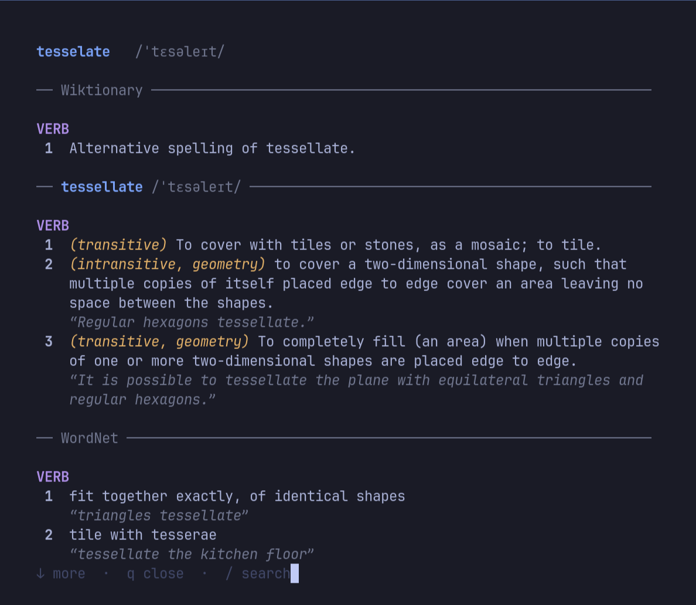

# lexi

A fast, offline English dictionary for Linux and macOS. Press a key, type a word and get a clean popup with definitions, pronunciation, examples and etymology. It also works as a plain terminal command, and on macOS as an [Alfred workflow](alfred/) or a [Raycast extension](raycast/).



- **Offline:** about 1.5 million entries from [Wiktionary](https://en.wiktionary.org) and [Open English WordNet](https://en-word.net). Lookups take well under 0.1 seconds.
- **Modern:** Wiktionary is current, so it has words like *doomscrolling* and *rizz*.
- **Follows references:** a word that only says "Alternative spelling of X" or "past tense of X" shows X's full definitions underneath.
- **Forgives typos:** *arbitrtion* suggests *arbitration* and shows it.
- **Any language, both ways:** add Danish, Swedish, German or any other language Wiktionary has, and *dog* also shows *en hund*, while *hund* shows its English meanings, inflections and pronunciation.
- **A word journey:** type the next word straight into the popup, or click any word in the text. ← and → go back and forward.
- **Fits the window to the content** on Hyprland and [Omarchy](https://omarchy.org): floating, centered and as tall as the entry needs.
- **No dependencies** beyond Python 3, which is already on most systems.

## Install

```bash
git clone https://github.com/rallevondalle/lexi.git
cd lexi
./install.sh
```

The installer:

1. Copies `lexi` to `~/.local/bin`.
2. Downloads the dictionaries (about 540 MB) and builds a local database (about 360 MB). This takes a few minutes, and the downloads are not kept.
3. On Omarchy, binds **SUPER + ALT + D** to the popup. On other desktops it tells you what to bind.

Options: `--lang da` for a Danish interface (which also adds the Danish dictionary), `--language NAME` to add a language (repeatable, e.g. `--language Swedish`), `--no-data` to skip the download, and `--no-keybinding`.

## Usage

```bash
lexi serendipity        # print the definition in the terminal
lexi                    # ask for a word and show it in a popup
lexi --open serendipity # open the popup for a word directly
lexi settings           # open the settings in the popup
lexi add Danish Swedish # download languages (a few minutes each time)
lexi remove Swedish     # remove a language
lexi languages --all    # every language you can add
lexi update             # refresh the dictionaries from the latest Wiktionary dump
lexi --json serendipity # the lookup as JSON, for integrations
lexi --complete seren   # words starting with "seren", as JSON
```

In the popup:

| | |
|---|---|
| Type a word, Enter | look it up (Tab completes) |
| Click a word | look it up |
| ← → | back and forward through the words you looked up |
| ↑ ↓, PgUp PgDn, Space, mouse wheel | scroll |
| Ctrl+S | settings |
| Esc | clear what you typed, or close |

Clicking takes over the mouse, so hold Shift to select text.

## Works with

| | Terminal lookups | Popup | Popup sized to content |
|---|---|---|---|
| Omarchy | ✓ | ✓ | ✓ |
| Hyprland | ✓ | ✓ | ✓ |
| Other Linux desktops | ✓ | ✓ (normal terminal window) | |
| macOS | ✓ | ✓ with [Alfred](alfred/) or [Raycast](raycast/), or Terminal.app | Alfred, Raycast |

lexi asks for the word using the first of these it finds: `omarchy-menu-input`, `fuzzel`, `wofi`, `tofi`, `rofi`, `bemenu`, `zenity`, `kdialog` or, on macOS, a native dialog. If none is available, it asks inside the popup.

The popup opens in the first available terminal: `foot`, `kitty`, `alacritty`, `ghostty`, `wezterm`, `xdg-terminal-exec`, `gnome-terminal`, `konsole` or `xterm`, and on macOS Terminal.app.

### macOS: Alfred and Raycast

On macOS the nicest way to use lexi is from a launcher. Install lexi with `./install.sh` first.

- **[Alfred workflow](alfred/):** words appear as you type, each with its first definition, and ↩ shows the full entry. Every word you open is saved, so the keyword on its own lists the words you have looked up. A second keyword holds the settings: interface language, WordNet and dictionaries. See [alfred/README.md](alfred/README.md).
- **[Raycast extension](raycast/):** words appear as you type, and the definition shows in Raycast's detail pane. It can also look up the word you have selected in any app. See [raycast/README.md](raycast/README.md).

## Configuration

`~/.config/lexi/config`:

```ini
lang = en          # interface language: en or da
font_size = 12     # popup font size
width = 76         # text column width
terminal = kitty   # preferred terminal for the popup
wordnet = on       # show WordNet's definitions below Wiktionary's
```

The settings page in the popup (Ctrl+S, or `lexi settings`) changes these too.

### Other languages

Open the settings, type to filter the list of languages, press Space on the ones you want and Enter to download them. The download runs in the background, and a notification tells you when it's done. From the terminal: `lexi add Danish`.

Each language adds two sections to lookups:

- **English → Danish** for English words, from Wiktionary's translation tables. Nouns show their gender (*en hund*, *Hund m*). Inflected forms use their base word, so *ran* shows the translations of *run*.
- **Danish → English** for words in that language, with inflections and pronunciation. Inflected forms such as *hunden* show *hund*.

Words in a language are also explained, so you understand them and not only their English translation:

- **Danish** gets Danish definitions in Danish: from the [Danish Wiktionary](https://da.wiktionary.org) (about 11,000 words, with examples) and otherwise from [DanNet](https://wordnet.dk) (about 52,000 words; its definitions are shortened by design).
- **Every language** shows the English definition of what a word translates to, e.g. *transitiv* → *transitive*, when there is no definition in the language itself.

A word in both languages, such as *and* (Danish for duck), shows both. The translations into a language are in the English Wiktionary download, so adding languages downloads it again (about 535 MB); languages added together share one download. Each language is a separate file in `~/.local/share/lexi/languages/`.

Each setting can also be set as an environment variable, e.g. `LEXI_LANG=da`.

## Uninstall

```bash
./uninstall.sh          # keeps the dictionary database
./uninstall.sh --purge  # removes everything
```

## Data and licenses

lexi is MIT licensed. The dictionary data is downloaded from its sources and is not part of this repository:

- Wiktionary content (English and the languages you add) via [kaikki.org](https://kaikki.org) (Wiktextract), licensed [CC BY-SA 4.0](https://creativecommons.org/licenses/by-sa/4.0/) and GFDL.
- [Open English WordNet](https://github.com/globalwordnet/english-wordnet), licensed [CC BY 4.0](https://creativecommons.org/licenses/by/4.0/).
- With Danish: the [Danish Wiktionary](https://da.wiktionary.org) (CC BY-SA 4.0) and [DanNet](https://wordnet.dk/dannet) by the University of Copenhagen and the Danish Language and Literature Society (CC BY-SA 4.0).
